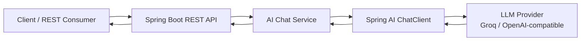

# Java AI Integration Platform

A small, extensible Spring Boot REST API that connects Java applications to Large Language Models through **Spring AI** and an OpenAI-compatible provider endpoint.

The default configuration targets Groq's OpenAI-compatible API. You can point it at another compatible endpoint by changing environment variables; the application code does not need provider-specific SDK calls.

## Architecture



### Request flow

1. A client sends a JSON request to the REST controller.
2. Jakarta Bean Validation checks the request.
3. The service calls Spring AI's `ChatClient`.
4. Spring AI communicates with the configured model provider.
5. The API returns the generated answer as JSON.

## Technology stack

- Java 17
- Spring Boot 3.4
- Spring AI
- Maven
- REST APIs
- Jakarta Bean Validation
- Spring Boot Actuator

## Prerequisites

- JDK 17 or newer
- Maven 3.9+
- An API key for the configured AI provider

## Run locally

Set the provider configuration in your shell:

```bash
export AI_API_KEY="your-api-key"
export AI_BASE_URL="https://api.groq.com/openai"
export AI_MODEL="llama-3.3-70b-versatile"
```

On PowerShell:

```powershell
$env:AI_API_KEY = "your-api-key"
$env:AI_BASE_URL = "https://api.groq.com/openai"
$env:AI_MODEL = "llama-3.3-70b-versatile"
```

Start the application:

```bash
mvn spring-boot:run
```

The API starts at `http://localhost:8080`.

## API

### POST /api/v1/ai/chat

Request:

```http
POST http://localhost:8080/api/v1/ai/chat
Content-Type: application/json

{
  "message": "Explain how a Java application communicates with an LLM."
}
```

Example response:

```json
{
  "answer": "A Java application can call an LLM through an integration layer...",
  "modelProvider": "configured-provider"
}
```

### Health check

```http
GET http://localhost:8080/actuator/health
```

## Configuration

| Environment variable | Default | Purpose |
|---|---|---|
| `AI_API_KEY` | replace-me | Provider API key |
| `AI_BASE_URL` | Groq-compatible URL | OpenAI-compatible API base URL |
| `AI_MODEL` | llama-3.3-70b-versatile | Model identifier |
| `SERVER_PORT` | 8080 | HTTP port |

Never commit real API keys. Use environment variables or a secrets manager in deployed environments.

## Project structure

```text
src/main/java/dev/udayshetty/aiplatform/
├── api/
│   ├── AiChatController.java
│   ├── ApiExceptionHandler.java
│   ├── ChatRequest.java
│   └── ChatResponse.java
├── service/
│   └── AiChatService.java
└── JavaAiIntegrationApplication.java
src/main/resources/application.yml
src/test/java/
```

## Current scope and next steps

This repository is a starter integration demonstrating the REST-to-LLM request path. It does not yet implement document ingestion, embeddings, retrieval-augmented generation (RAG), authentication, rate limiting, or persistent conversation history. Those are natural extensions for a production-oriented system.

## License

MIT